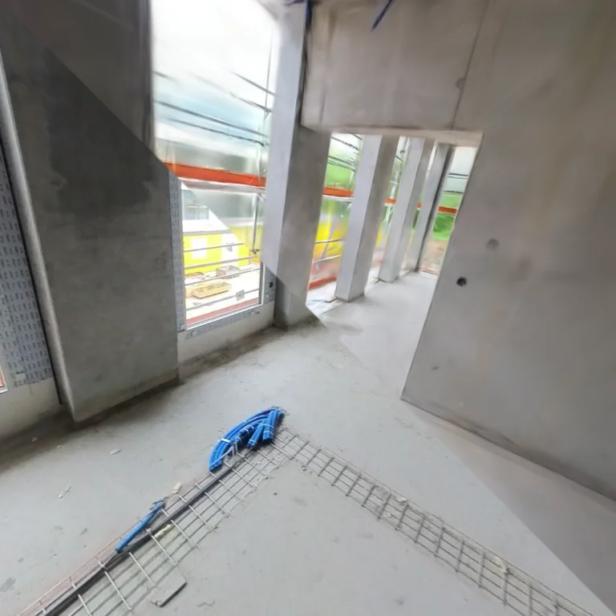
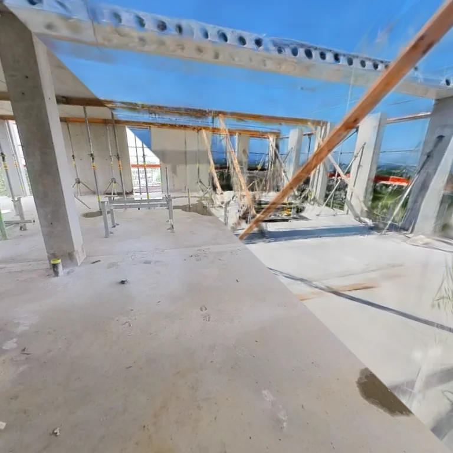
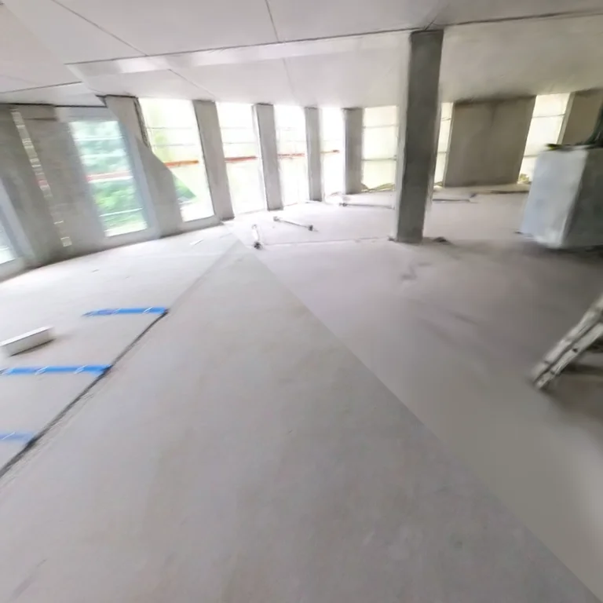
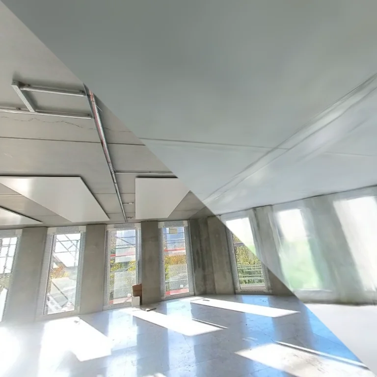

<h1 align="center">Sparse Anchors for Visual Multi-Session Registration in Changing Environments</h1>

<p align="center">
  <a href="https://scholar.google.com/citations?user=BN7LeywAAAAJ">Yunus Talha Erzurumlu</a> ·
  <a href="https://scholar.google.de/citations?hl=en&user=_xJ5rVwAAAAJ">Niklas Trekel</a> ·
  <a href="https://scholar.google.com/citations?user=qCVVRqIAAAAJ&hl">Saurabh Gupta</a> ·
  <a href="hhttps://scholar.google.com/citations?user=uvXUdWwAAAAJ&hl">Nico Koltermann</a> ·
  <a href="https://scholar.google.com/citations?hl=en&oi=ao&user=YwPsGKQAAAAJ">Olga Vysotska</a> ·
  <a href="https://scholar.google.com/citations?user=L4LZHXsAAAAJ&hl">Jens Behley</a> ·
  <a href="https://scholar.google.com/citations?user=EEyCOpIAAAAJ&hl">Louis Wiesmann</a> ·
  <a href="https://scholar.google.com/citations?user=8vib2lAAAAAJ">Cyrill Stachniss</a>
</p>

<p align="center">
  <a href="https://arxiv.org/abs/2611.05084"></a>
  
  
  <a href="LICENSE"></a>
</p>

This repository contains the code for registering a new visual
recording to a reference map in a changing environment. Sparse, reliable
cross-session pose estimates anchor the query trajectory, while within-session
relative poses connect the parts that cannot be localized independently.


## Abstract
<details>
<summary><strong>[Click to expand]</strong></summary>
Repeated robotic monitoring requires localization across visits to the same
environment, even as the environment changes. Changes in appearance and
structure can leave only parts of a new recording suitable for reliable
cross-session localization. We register the complete query trajectory to a
previously reconstructed reference map using sparse absolute pose constraints
and within-session relative poses. Visual place recognition, local feature
matching, and geometric verification provide candidate poses; sequence consensus
selects anchors consistent with a common alignment. Featuremetric alignment
against a Gaussian feature field refines the anchors, which are combined with
relative-pose constraints in robust pose-graph optimization.
</details>

## Method

The pipeline first proposes query poses through retrieval, matching, and PnP.
Sequence consensus selects poses that agree on a common alignment. We then
refine selected anchors against the reference Gaussian feature field and combine
them with the query session's relative poses in a pose graph.

### Featuremetric refinement

The examples below show how refinement adjusts a camera pose. The query image
stays fixed while the reference map is rendered at the optimizer's current
pose; the diagonal comparison reveals how the two views come into alignment.
Each example starts from a PnP prediction and shows recorded optimizer
steps. The full render is revealed at the end.

| Floor 1 | Floor 6 |
|:---:|:---:|
|  |  |
| Floor 1 | Floor 2 |
|  |  |

## Installation

### 1. Prepare the environment

Clone this repository and enter its directory:

```bash
git clone https://github.com/PRBonn/sparse-anchors.git
cd sparse-anchors
```

Replace each `<...>` path placeholder in the instructions and config with a
path on your machine before running the commands.

Python 3.11 or newer, [uv](https://docs.astral.sh/uv/), and a CUDA-capable GPU
are required for training and rendering. The lockfile records the resolved
versions, including PyTorch 2.10.0 with CUDA 12.8 and a pinned gsplat commit.
Use a compatible NVIDIA driver and CUDA build environment.

### 2. Install dependencies

From the repository root, run:

```bash
uv sync --frozen --extra dev --extra viewer --extra matching \
  --no-build-isolation --no-install-package gsplat
uv sync --frozen --extra dev --extra viewer --extra matching \
  --no-build-isolation
```

The first command installs PyTorch; the second builds gsplat against it. DINOv3
weights are obtained separately from Hugging Face.

## Data

The [HILTI26 dataset repository](https://github.com/Hilti-Research/hilti-trimble-slam-challenge-2026)
provides dataset access and preparation tools. Follow its instructions to
obtain the recordings, then place the source sessions together under
`<HILTI_DATA_ROOT>`. The reference and query each need their own COLMAP
reconstruction because they are separate recordings. The helper below runs the
same conversion and reconstruction steps for both. Only the reference needs
DINOv3 features, DA3 depth, and a trained Gaussian map.

A scene used for Gaussian training has the following layout:

```text
scene/
  sparse/0/              # COLMAP reconstruction
  images/                # registered RGB images
  masks/                 # valid-pixel masks, e.g. cam0/frame.png.png
  features/dinov3/
    manifest.json
    maps/                # per-image feature maps
  depth/da3/             # DA3 depth and confidence NPZ files
```

The feature manifest maps COLMAP image names to `.npy` feature maps. DINOv3
features and DA3 depths are scene-level caches; alternate paths can be specified
with `--feature-manifest` and `--da3-depth-dir`. Set
`--da3-depth-loss-weight 0` to train without DA3 depth supervision.

## Usage

### 1. Extract DINOv3 features

```bash
.venv/bin/python tools/splatting/extract_features.py \
  --scene <REFERENCE_SCENE>
```

The default extractor is DINOv3 ViT-S/16 with 384 channels. Use
`--dinov3-hf-model` to select a different Hugging Face DINOv3 model.

### 2. Create DA3 depth maps (optional)

For HILTI scenes, pose-conditioned DA3 depth maps can be generated separately
and used for Gaussian training. Initialize the pinned DA3 source and install
the inference dependencies:

```bash
git submodule update --init thirdparty/Depth-Anything-3
uv sync --frozen --extra dev --extra viewer --extra matching \
  --no-build-isolation --no-install-package gsplat
uv sync --frozen --extra dev --extra viewer --extra matching --extra da3 \
  --no-build-isolation
```

```bash
.venv/bin/python tools/hilti/cache_da3_depth.py --scene <REFERENCE_SCENE>
```

This writes depth and confidence caches to `scene/depth/da3/`, where training
loads them by default. Use `--da3-depth-dir` when training with caches in a
different folder, or `--da3-depth-loss-weight 0` to train without them.
Depth supervision uses the scene's valid-pixel masks and excludes DA3 confidence
below 1.3; change the threshold with `--da3-confidence-threshold`.

### 3. Train the reference Gaussian map

```bash
.venv/bin/sparse-anchors train \
  --scene <REFERENCE_SCENE> \
  --output-dir <REFERENCE_SPLAT_RUN> \
  --steps 30000 \
  --steps-scaler 2 \
  --checkpoint-every 5000 \
  --log-every 100 \
  --data-loader-workers 4 \
  --data-loader-prefetch-factor 2 \
  --viewer \
  --viewer-port 8080 \
  --viewer-resolution 768
```

Open `http://localhost:8080` to see the live viewer. This example trains for
60,000 steps: the target is `steps * steps_scaler`. Each run saves `run.json`
with its scene, caches, train/evaluation image lists, and latest checkpoint.
To resume, use the same scene and output directory and add, for example,
`--resume <REFERENCE_SPLAT_RUN>/checkpoint_005000.pt`.

### 4. Register a query session

Edit [configs/localization_exp.py](configs/localization_exp.py): set
`data_root`, `reference_splat_run`, and `output_dir`. Reference and query
session paths are derived from `data_root` and the two session names. Then run
the complete localization and evaluation pipeline:

```bash
scripts/run_localization.sh
```

The helper runs VPR and rig PnP, sequence consensus, both pose-graph variants,
featuremetric anchor refinement, final PGO, and evaluation. To rerun only the
evaluator, use `.venv/bin/python -m scripts.evaluate`.

The consensus, pose graph, and featuremetric runners also accept explicit input
and output paths; use `--help` to see their options. Each experiment should have
its own output directory. VPR descriptors and image matches are cached there;
the caches are reused on subsequent runs and are not checked against changed
inputs or parameters. Use a new directory when those change. Scene-level DINOv3
and DA3 caches remain in the scene directory.

```text
run/
  pnp/                   # VPR, matching, depth lifting, and PnP results and caches
  consensus/             # selected anchors, consensus alignment, and trajectory
  pose_graph/            # PnP-all and consensus-anchor PGO trajectories
  featuremetric/         # refined anchors and final PGO trajectory
  evaluation/
    metrics.csv          # per-pose errors for every available stage
    metrics.json         # aggregate metrics by stage
    summary.txt          # printed report, also saved to disk
    plots/               # VPR, matching, anchors, and trajectory maps
```

The evaluator reports raw PnP, consensus anchors and alignment, both pose-graph
variants, featuremetric anchors, and the final featuremetric-plus-PGO trajectory
when those artifacts are present. The pose graph runner saves its two variants
in `pose_graph/`; featuremetric refinement initializes from the consensus PGO
trajectory.

### 4. Render or view a map

```bash
.venv/bin/sparse-anchors render --run-dir <REFERENCE_SPLAT_RUN>
.venv/bin/sparse-anchors viewer --run-dir <REFERENCE_SPLAT_RUN> --port 8080
```

Renders are saved under the run's `renders/` directory. Use `--checkpoint` to
select another checkpoint or `--output-dir` to change the render destination.
The saved checkpoint transform determines the render coordinate frame.

## Reproducing the HILTI results
<details>
<summary><strong>[Click to expand]</strong></summary>

The paper uses HILTI26 recordings sampled at **2 Hz per camera**. Obtain the
recordings and preparation metadata from the
[HILTI26 dataset repository](https://github.com/Hilti-Research/hilti-trimble-slam-challenge-2026).
The commands below show how to prepare the reference and query sessions with
this repository's pinhole converter and LoMa-enabled COLMAP runner.

### 1. Arrange the source recordings

Put both extracted recordings beneath one data root. Each source session must
contain synchronized fisheye images and metadata:

```text
<HILTI_DATA_ROOT>/
  floor_1_2025-05-05_run_1/  # reference source
    images/cam0/<timestamp>.png
    images/cam1/<timestamp>.png
    frames.csv
    cameras.json
  floor_1_2025-07-07_run_1/  # query source
    images/cam0/<timestamp>.png
    images/cam1/<timestamp>.png
    frames.csv
    cameras.json
```

`frames.csv` contains synchronized timestamps, image paths, and camera poses.
`cameras.json` contains the fisheye intrinsics, distortion coefficients, and
the transform between `cam0` and `cam1`. Replace `<HILTI_DATA_ROOT>` below
with the directory containing these two source folders.

### 2. Convert both sessions to pinhole views

The converter creates eight virtual camera images per timestamp, along with
converted `frames.csv` and `cameras.json` files and geometric valid-view
masks. Run it once for each recording:

```bash
DATA_ROOT="<HILTI_DATA_ROOT>"
REFERENCE_SOURCE="$DATA_ROOT/floor_1_2025-05-05_run_1"
QUERY_SOURCE="$DATA_ROOT/floor_1_2025-07-07_run_1"
REFERENCE="$DATA_ROOT/floor_1_2025-05-05_run_1_pinhole"
QUERY="$DATA_ROOT/floor_1_2025-07-07_run_1_pinhole"

.venv/bin/python tools/hilti/convert_to_pinhole.py \
  --input "$REFERENCE_SOURCE" --out "$REFERENCE" --clean
.venv/bin/python tools/hilti/convert_to_pinhole.py \
  --input "$QUERY_SOURCE" --out "$QUERY" --clean
```

Defaults are 768 x 768 images, a 90 degree field of view, and `best` single-camera
fusion. The eight virtual camera names are `cam0_left`, `cam0_right`,
`cam0_up`, `cam0_down`, `cam1_left`, `cam1_right`,
`cam1_up`, and `cam1_down`.

The converter writes geometric masks to `masks/<camera>.png`. Query
featuremetric refinement also uses per-image dynamic masks. Generate or obtain
these and put them under `$QUERY/masks/<camera>/<image-name>.png.png`, matching
the query image names. We generated our masks with SAM 3 and plan to share them.

### 3. Create the COLMAP models with our runner

Use COLMAP **4.2.0.dev0**, commit `d2da1944`, built with CUDA and the LoMa
feature/matching modules. Make `colmap` and `sqlite3` available on `PATH`.
Run the repository script on each converted session:

```bash
tools/hilti/run_colmap_loma.sh "$REFERENCE"
tools/hilti/run_colmap_loma.sh "$QUERY"
```

The runner prepares the rig metadata, extracts LoMa features, performs rig-aware
matching, and runs sparse mapping. It writes each model to
`<SESSION_PINHOLE>/colmap_loma_rig/sparse/0/`, which is exactly the model
directory read by the config. The resulting layout is:

```text
<SESSION_PINHOLE>/
  frames.csv
  cameras.json
  images/<virtual-camera>/<timestamp>.png
  masks/
    <virtual-camera>.png              # geometric valid-view mask
    <virtual-camera>/<image>.png.png  # per-image mask, if supplied
  colmap_loma_rig/
    images -> ../images
    database.db
    cameras.tsv
    rig_config.json
    image_lists/
    sparse/0/                          # COLMAP model used by localization
```

The COLMAP script rebuilds its database and sparse model when run again. You can
run both conversion and reconstruction steps together with
`tools/hilti/prepare_pair.sh "$DATA_ROOT" floor_1_2025-05-05_run_1 floor_1_2025-07-07_run_1`.

### 4. Set the config paths

Set the data root, prepared session paths, reference splat output, and
localization output in `configs/localization_exp.py`. For example:

```python
data_root = Path("<HILTI_DATA_ROOT>")
reference_session = data_root / "floor_1_2025-05-05_run_1_pinhole"
query_session = data_root / "floor_1_2025-07-07_run_1_pinhole"
reference_root = reference_session
query_root = query_session
reference_splat_run = Path("runs/floor1_0505_reference")
output_dir = Path("runs/floor1_0505_to_0707")
```

`checkpoint` is derived from `reference_splat_run` as
`checkpoint_060000.pt`. The reference and query roots must contain the
`colmap_loma_rig/sparse/0` model from the previous step. Keep the query's per-image
masks under `query_session/masks/`.

### 5. Run depth, features, Gaussian training, and localization

Initialize DA3 and install the dependencies needed for depth caching and
training. The first sync installs PyTorch; the second builds gsplat and adds
DA3 support:

```bash
git submodule update --init thirdparty/Depth-Anything-3
uv sync --frozen --extra dev --extra viewer --extra matching \
  --no-build-isolation --no-install-package gsplat
uv sync --frozen --extra dev --extra viewer --extra matching --extra da3 \
  --no-build-isolation
```

Then run the stages that use the prepared session folders:

```bash
tools/hilti/run_prepared_pair.sh
```

This creates DA3 depth and DINOv3 features for the reference, trains its
Gaussian map for 60,000 steps, and runs localization and evaluation. It uses
the existing pinhole images and COLMAP models; it does not reconvert or rerun
COLMAP. The splat and localization results are written to `reference_splat_run/`
and `output_dir/`.

For raw source sessions, you can instead run
`tools/hilti/reproduce_pair.sh "<QUERY_DYNAMIC_MASKS_DIR>"` after setting the
config paths. This runs conversion and our COLMAP runner for both sessions,
copies the supplied query masks, then runs the depth, feature, training, and
localization stages above.
</details>

## Citation

```bibtex
@article{erzurumlu2026arxiv,
  author  = {Y. T. Erzurumlu and N. Trekel and S. Gupta and N. Koltermann and O. Vysotska and J. Behley and L. Wiesmann and C. Stachniss},
  title   = {{Sparse Anchors for Visual Multi-Session Registration in Changing Environments}},
  journal = {arXiv preprint},
  year    = 2026,
  volume  = {arXiv:2611.05084},
  url     = {https://arxiv.org/pdf/2611.05084},
}
```
