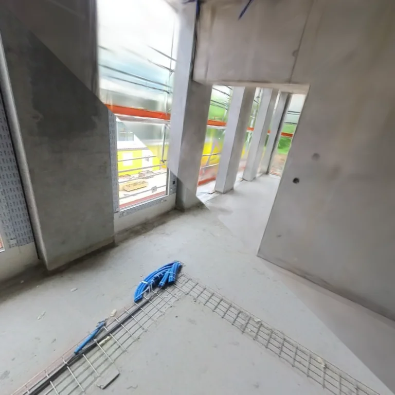
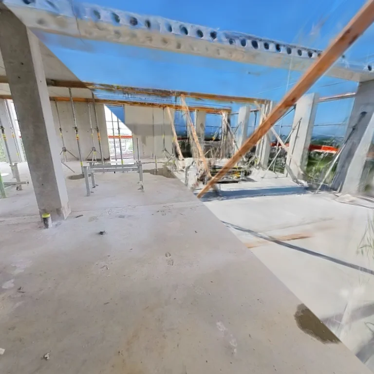
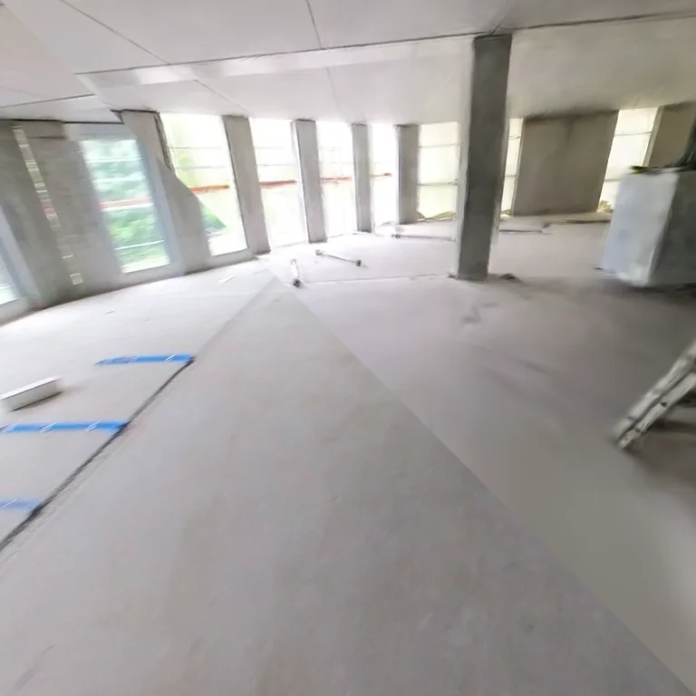
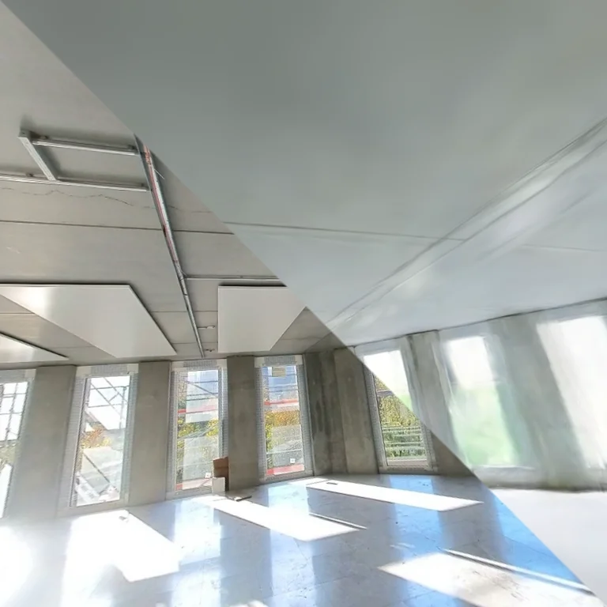

<h1 align="center">Sparse Anchors for Visual Multi-Session Registration in Changing Environments</h1>

<p align="center">
  <a href="https://scholar.google.com/citations?user=BN7LeywAAAAJ">Yunus Talha Erzurumlu</a> ·
  <a href="https://scholar.google.de/citations?hl=en&user=_xJ5rVwAAAAJ">Niklas Trekel</a> ·
  <a href="https://scholar.google.com/citations?user=qCVVRqIAAAAJ&hl">Saurabh Gupta</a> ·
  <a href="https://www.ipb.uni-bonn.de/people/nico-koltermann/index.html">Nico Koltermann</a> ·
  <a href="https://scholar.google.com/citations?hl=en&oi=ao&user=YwPsGKQAAAAJ">Olga Vysotska</a> ·
  <a href="https://scholar.google.com/citations?user=L4LZHXsAAAAJ&hl">Jens Behley</a> ·
  <a href="https://scholar.google.com/citations?user=EEyCOpIAAAAJ&hl">Louis Wiesmann</a> ·
  <a href="https://scholar.google.com/citations?user=8vib2lAAAAAJ">Cyrill Stachniss</a>
</p>

<p align="center">
  <a href="https://arxiv.org/abs/2611.05084"></a>
  
  
  <a href="LICENSE"></a>
</p>

This repository contains the research code for registering a new visual
recording to a reference map in a changing environment. Sparse, reliable
cross-session pose estimates anchor the query trajectory, while within-session
relative poses connect the parts that cannot be localized independently.


*Illustration of multi-session alignment and registered views.*

## Abstract

Repeated robotic monitoring requires localization across visits to the same
environment, even as the environment changes. Changes in appearance and
structure can leave only parts of a new recording suitable for reliable
cross-session localization. We register the complete query trajectory to a
previously reconstructed reference map using sparse absolute pose constraints
and within-session relative poses. Visual place recognition, local feature
matching, and geometric verification provide candidate poses; sequence consensus
selects anchors consistent with a common alignment. Featuremetric alignment
against a Gaussian feature field refines the anchors, which are combined with
relative-pose constraints in robust pose-graph optimization.

## Method

The pipeline first proposes query poses through retrieval, matching, and PnP.
Sequence consensus selects poses that agree on a common alignment. We then
refine selected anchors against the reference Gaussian feature field and combine
them with the query session's relative poses in a pose graph.

### Featuremetric refinement

The examples below show how refinement adjusts a camera pose. The query image
stays fixed while the reference map is rendered at the optimizer's current
pose; the diagonal comparison reveals how the two views come into alignment.
Each example starts from a PnP prediction and shows recorded optimizer
steps. The full render is revealed at the end.

| Floor 1 | Floor 6 |
|:---:|:---:|
|  |  |
| Floor 1 | Floor 2 |
|  |  |

## Installation

### 1. Prepare the environment

Python 3.11 or newer, [uv](https://docs.astral.sh/uv/), and a CUDA-capable GPU
are required for training and rendering. The lockfile records the resolved
versions, including PyTorch 2.10.0 with CUDA 12.8 and a pinned gsplat commit.
Use a compatible NVIDIA driver and CUDA build environment.

### 2. Install dependencies

From the repository root, run:

```bash
uv sync --frozen --extra dev --extra viewer --extra matching \
  --no-build-isolation --no-install-package gsplat
uv sync --frozen --extra dev --extra viewer --extra matching \
  --no-build-isolation
```

The first command installs PyTorch; the second builds gsplat against it. DINOv3
weights are obtained separately from Hugging Face.

## Data

The pipeline uses undistorted COLMAP pinhole reconstructions. The reference
scene also needs images, valid-pixel masks, DINOv3 features, and a trained
Gaussian map. The example configuration expects HILTI-style session metadata
in `frames.csv` and timestamped camera images.

A scene used for Gaussian training has the following layout:

```text
scene/
  sparse/0/              # COLMAP reconstruction
  images/                # registered RGB images
  masks/                 # valid-pixel masks, e.g. cam0/frame.png.png
  features/dinov3/
    manifest.json
    maps/                # per-image feature maps
  depth/da3/             # DA3 depth and confidence NPZ files
```

The feature manifest maps COLMAP image names to `.npy` feature maps. DINOv3
features and DA3 depths are scene-level caches; alternate paths can be specified
with `--feature-manifest` and `--da3-depth-dir`. Set
`--da3-depth-loss-weight 0` to train without DA3 depth supervision.

## Usage

### 1. Extract DINOv3 features

```bash
.venv/bin/python tools/splatting/extract_features.py \
  --scene /path/to/reference/scene
```

The default extractor is DINOv3 ViT-S/16 with 384 channels. Use
`--dinov3-hf-model` to select a different Hugging Face DINOv3 model.

### 2. Create DA3 depth maps (optional)

For HILTI scenes, pose-conditioned DA3 depth maps can be generated separately
and used for Gaussian training. Initialize the pinned DA3 source and install
the inference dependencies:

```bash
git submodule update --init thirdparty/Depth-Anything-3
uv sync --frozen --extra dev --extra viewer --extra matching --extra da3 \
  --no-build-isolation
```

```bash
.venv/bin/python tools/hilti/cache_da3_depth.py --scene /path/to/reference/scene
```

This writes depth and confidence caches to `scene/depth/da3/`, where training
loads them by default. Use `--da3-depth-dir` when training with caches in a
different folder, or `--da3-depth-loss-weight 0` to train without them.
Depth supervision uses the scene's valid-pixel masks and excludes DA3 confidence
below 1.3; change the threshold with `--da3-confidence-threshold`.

### 3. Train the reference Gaussian map

```bash
.venv/bin/sparse-anchors train \
  --scene /path/to/reference/scene \
  --output-dir /path/to/splat_run \
  --steps 30000 \
  --steps-scaler 2 \
  --checkpoint-every 5000 \
  --log-every 100 \
  --data-loader-workers 4 \
  --data-loader-prefetch-factor 2 \
  --viewer \
  --viewer-port 8080 \
  --viewer-resolution 768
```

Open `http://localhost:8080` to see the live viewer. This example trains for
60,000 steps: the target is `steps * steps_scaler`. Each run saves `run.json`
with its scene, caches, train/evaluation image lists, and latest checkpoint.
To resume, use the same scene and output directory and add, for example,
`--resume /path/to/splat_run/checkpoint_005000.pt`.

### 4. Register a query session

Edit [configs/localization_exp.py](configs/localization_exp.py) to set the
reference and query paths, reference checkpoint, experiment parameters, and
`output_dir`. The paths in the checked-in example are machine-specific and
must be changed for your data. Run the stages from the repository root:

```bash
# VPR, image matching, depth lifting, and rig PnP
.venv/bin/python -m scripts.run_rig_pnp

# Sequence consensus and pose graph optimization
.venv/bin/python -m scripts.run_sequence_consensus
.venv/bin/python -m scripts.run_pose_graph

# Featuremetric anchor refinement and final pose graph optimization
.venv/bin/python -m scripts.run_consensus_featuremetric
```

To evaluate PnP hypotheses when the required ground-truth data is available:

```bash
.venv/bin/python -m scripts.evaluate_rig_pnp
```

The consensus, pose graph, and featuremetric runners also accept explicit input
and output paths; use `--help` to see their options. Each experiment should have
its own output directory. VPR descriptors and image matches are cached there;
the caches are reused on subsequent runs and are not checked against changed
inputs or parameters. Use a new directory when those change. Scene-level DINOv3
and DA3 caches remain in the scene directory.

```text
run/
  cache/vpr/             # query and reference descriptors
  cache/matches/         # image pair matches
  retrievals.json        # VPR candidates
  match_rows.json        # matching and depth-lifting results
  pose_estimates.json    # PnP hypotheses
  metrics.json, plots/   # optional PnP evaluation
  consensus/             # selected anchors, consensus, and PGO trajectories
  featuremetric/         # refined anchors and final PGO trajectory
```

The pose graph runner saves both all-PnP and consensus-anchor variants.
Featuremetric refinement starts from the consensus graph and saves a final
pose graph in `featuremetric/`.

### 4. Render or view a map

```bash
.venv/bin/sparse-anchors render --run-dir /path/to/splat_run
.venv/bin/sparse-anchors viewer --run-dir /path/to/splat_run --port 8080
```

Renders are saved under the run's `renders/` directory. Use `--checkpoint` to
select another checkpoint or `--output-dir` to change the render destination.
The saved checkpoint transform determines the render coordinate frame.

## Reproducing the HILTI results

The paper's main results use 3D Gaussian Splatting (3DGS). Get the HILTI26 data
using the [dataset repository](https://github.com/Hilti-Research/hilti-trimble-slam-challenge-2026)
and its tools. The fisheye images used in our experiments are sampled at
**2 Hz per camera**.

### Dataset layout

Before pinhole conversion, each recording should have the extracted source
fisheye images and metadata:

```text
run_source/
  images/
    cam0/<timestamp>.png
    cam1/<timestamp>.png
  frames.csv
  cameras.json
```

`frames.csv` contains the synchronized timestamps, source camera names, image
paths, and camera poses. `cameras.json` contains fisheye intrinsics, distortion,
and the `cam0` to `cam1` transform. The pinhole conversion creates the eight
virtual views and their metadata. Per-image dynamic masks are a replaceable
preprocessing input. The scripts expect them at
`masks/<camera>/<image-name>.png.png`:

```text
run_pinhole/
  images/<camera>/<timestamp>.png
  masks/<camera>/<image-name>.png.png
  frames.csv
  cameras.json
  colmap_loma_rig/       # created by the COLMAP step below
```

The virtual camera names are `cam0_left`, `cam0_right`, `cam0_up`, `cam0_down`,
`cam1_left`, `cam1_right`, `cam1_up`, and `cam1_down`. We generated the dynamic
masks with SAM 3. You can generate your own masks; we plan to share the masks
used in our runs as well. The converter's geometric valid-view masks are stored as
`masks/<camera>.png`.

### Prepare the pinhole scenes

Run the converter for each reference or query recording:

```bash
.venv/bin/python tools/hilti/convert_to_pinhole.py \
  --input /path/to/hilti/run_source \
  --out /path/to/hilti/run_pinhole \
  --clean
```

The converter defaults to 768 x 768 images, a 90 degree field of view, and
`best` single-camera fusion.

### COLMAP reconstruction

Use COLMAP **4.2.0.dev0**, commit `d2da1944` (CUDA build), with the LoMa feature
and matching modules enabled. Make `colmap` and `sqlite3` available on `PATH`.
Run this for each prepared recording:

```bash
tools/hilti/run_colmap_loma.sh /path/to/hilti/run_pinhole
```

This creates `run_pinhole/colmap_loma_rig/` with `images/`, `database.db`, and
`sparse/0/`. It also writes `rig_config.json` and per-camera image lists. The
Python helper [`prepare_colmap_rig.py`](tools/hilti/prepare_colmap_rig.py)
validates the synchronized eight-camera frames and derives the rig from the
first complete timestamp. The COLMAP settings are kept in the runner. Masks are
used by downstream stages, not by COLMAP.

### Depth, features, and reference map

Initialize DA3 and install its inference dependencies:

```bash
git submodule update --init thirdparty/Depth-Anything-3
uv sync --frozen --extra dev --extra viewer --extra matching --extra da3 \
  --no-build-isolation
```

Run DA3 depth and DINOv3 feature extraction for the reference COLMAP workspace:

```bash
REFERENCE=/path/to/hilti/floor_1_2025-05-05_run_1_pinhole
SCENE="$REFERENCE/colmap_loma_rig"
.venv/bin/python tools/hilti/cache_da3_depth.py --scene "$SCENE"
.venv/bin/python tools/splatting/extract_features.py \
  --scene "$SCENE" \
  --masks-dir "$REFERENCE/masks"
```

DA3 caches depth and confidence under `SCENE/depth/da3/`. DINOv3 features and
their manifest are written under `SCENE/features/dinov3/`. The scripts pin the
DA3 model and revision; the feature extractor defaults to DINOv3 ViT-S/16 with
384 channels. Hugging Face access may be required for its weights.

Train the reference 3DGS map:

```bash
.venv/bin/sparse-anchors train \
  --scene "$SCENE" \
  --masks-dir "$REFERENCE/masks" \
  --output-dir /path/to/hilti/splat_runs/reference \
  --steps 30000 \
  --steps-scaler 2 \
  --checkpoint-every 5000 \
  --log-every 100 \
  --data-loader-workers 4 \
  --data-loader-prefetch-factor 2 \
  --da3-confidence-threshold 1.3 \
  --viewer \
  --viewer-port 8080 \
  --viewer-resolution 768
```

This example trains for 60,000 steps. Training saves `run.json` and checkpoints
under the output directory. DA3 depth supervision is enabled by default and
uses pixels with confidence greater than or equal to 1.3. The live viewer is
available at `http://localhost:8080`.

### Localization

The checked-in [configs/localization_exp.py](configs/localization_exp.py)
already selects the paper's Floor 1 pair: the 2025-05-05 reference and
2025-07-07 query. Keep that pair and its experiment parameters. Update
`reference_root` and `query_root` only if the prepared scenes are stored at
different local paths. Set `checkpoint` to the trained reference checkpoint
from the previous step (for the example above,
`/path/to/hilti/splat_runs/reference/checkpoint_060000.pt`) and choose a writable
`output_dir` for the localization run. Both scene roots need `frames.csv`,
`masks/`, and `colmap_loma_rig/`; the reference COLMAP workspace also needs the
DINOv3 manifest. Then run from the repository root:

```bash
.venv/bin/python -m scripts.run_rig_pnp
.venv/bin/python -m scripts.run_sequence_consensus
.venv/bin/python -m scripts.run_pose_graph
.venv/bin/python -m scripts.run_consensus_featuremetric
```

## Repository structure

```text
configs/                        # experiment settings
scripts/                        # localization and evaluation runners
src/sparse_anchors/
  data/                         # COLMAP records and session metadata
  features/                     # DINOv3 feature extraction
  localization/                 # VPR, PnP, consensus, featuremetric, and PGO
  splatting/                    # Gaussian training, rendering, and viewer
  utils/                        # geometry, I/O, evaluation, and visualization
tools/                         # data preparation and diagnostic tools
```
